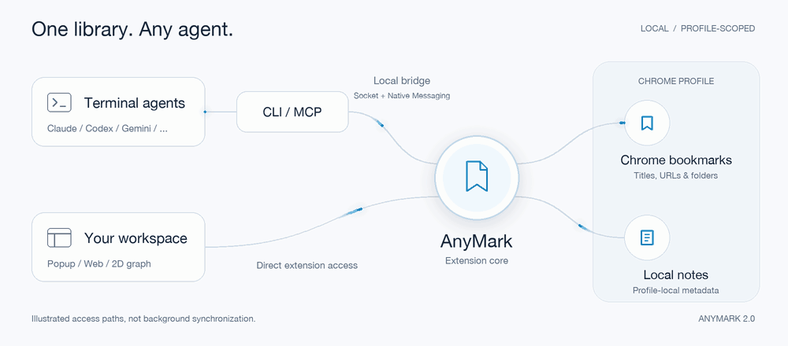

# AnyMark 2.0

**简体中文** · [English](README.en.md)

**将 Chrome 书签映射为本地文件系统接口，供终端 AI Agent 与人类共同维护。**

AnyMark 2.0 去掉了扩展内置的聊天窗口与模型配置，回归更直接的分工：Chrome 保存真实书签，扩展提供本地 Web 工作台与 Native Messaging 桥接，让你在终端里使用的 AI Agent（Claude Code、Codex、Cursor、Gemini CLI 等）通过熟悉的类 Unix 命令或 MCP 直接读写书签。

<picture>
  <source media="(prefers-reduced-motion: reduce)" srcset="docs/assets/architecture.png">
  
</picture>

---

## 核心特性

### 1. 面向 AI Agent 的 Relay 接口
- **文件系统语义**：书签文件夹对应目录（`/`），书签对应包含 `title`、`url`、`note` 的文件。支持 `ls`、`tree`、`find`、`stat`、`cat`、`mkdir`、`write`、`edit`、`mv`、`cp`、`rm`。
- **三种调用方式**：
  - **CLI 命令**：适合在终端或 Agent Bash 工具中直接调用。
  - **Agent Skill**：提供 [`skills/anymark/SKILL.md`](skills/anymark/SKILL.md) 规范文件，包含完整寻址规则与归档、去重、补备注标准流程。
  - **MCP Server**：标准 `stdio` 协议，可接入 Claude Desktop、Cursor、Codex 等客户端。
- **Web 指令台（Relay Console）**：工作台主页内置常用指令卡（归档 Inbox、重复项与结构体检、批量补备注），点击即可复制带当前目录 ID 与 Profile 上下文的 Prompt。
- **多 Profile 隔离**：每个 Chrome Profile 拥有独立连接开关与 `profileId`，多账号同时开启也不会串号。

### 2. 面向日常使用的本地工作台
- **Popup 快速收集（Inbox）**：在任意网页一键存入 `AnyMark Inbox` 并附上备注。`AnyMark Inbox` 文件夹仅在首次保存时按需创建。
- **本地备注（Local Notes）**：支持为书签和文件夹添加备注，保存在当前 Profile 本地存储中，不污染 Chrome 书签标题与 URL，但可用于搜索和为 AI 提供分类上下文。
- **全键盘与批量操作**：支持 `↑ / ↓` 移动焦点、`→ / Enter` 进入目录或打开网页、`←` 返回上级目录并自动定位、`Space` 开关右侧详情面板；支持 `Shift` 区间多选、批量移动、批量删除及一键复制选中项给 AI。
- **二维关系图谱**：按真实目录树渲染 2D 节点图，支持搜索过滤、分支聚焦与键盘方向键漫游。
- **HTML 备份与迁移**：导出兼容 Chrome 标准格式的 HTML 书签文件（同时内嵌 AnyMark 本地备注），导入时始终创建独立新文件夹，不覆盖现有数据。
- **多语言与主题**：内置 `简体中文`、`繁體中文`、`English`、`日本語` 四种语言及浅色 / 深色 / 跟随系统主题。

---

## 快速开始

**环境要求**：扩展需要 Chrome 134+。仅使用 Popup／Web 工作台不需要 Node.js 或本地连接器；可选的 CLI／MCP 连接器需要 Node.js 22+，目前仅支持 macOS 和 Linux，不支持 Windows。

### 1. 下载并加载扩展

从 [v2.0.1 Release](https://github.com/Johnny-xuan/Anymark/releases/tag/v2.0.1) 下载 **`anymark-v2.0.1-chrome-extension.zip`**。这是仅包含已构建扩展的 ZIP，无需安装依赖或运行构建。

1. 将 ZIP 解压到准备长期保留的目录。
2. 打开 `chrome://extensions`，开启右上角**开发者模式**。
3. 点击**加载已解压的扩展程序**，选择解压后包含 `manifest.json` 的目录。
4. 点击浏览器工具栏的 AnyMark 图标，可将当前网页加入 Inbox；点击 Popup 中的地球图标进入 Web 工作台。

到这里即可使用 Popup／Web 管理书签，不必开启 Agent 访问。

### 2. 可选：安装 CLI／MCP 本地连接器

需要终端 Agent 访问时，再从同一 Release 下载 **`anymark-v2.0.1-agent-connector-source.zip`**。这是连接器源码包，不是独立可执行程序，也不是 Chrome 扩展；需要联网安装 npm 依赖，但无需构建扩展。

将连接器源码解压到准备长期保留的目录，在包含 `package.json` 的目录执行：

```bash
npm ci --omit=dev
node bin/anymark.js install
```

安装会记录当前 Node 可执行文件和连接器目录的绝对路径；移动目录或更换 Node 路径后，请重新运行安装命令。若使用 Chromium，改用 `node bin/anymark.js install --browser chromium`。

> 可选：在该目录运行 `npm link`，将 `anymark` 注册为全局命令。若不使用 `npm link`，将下文的 `anymark` 替换为 `node bin/anymark.js`（在连接器目录执行），或使用 `node /absolute/path/to/Anymark/bin/anymark.js`。CLI／MCP 示例均以已安装连接器为前提。

### 3. 可选：开启 Agent 访问并绑定 Profile

1. 在 Popup 的「Agent 连接」或 Web 工作台的「设置 → Agent 与 MCP」中，开启**允许本机 Agent 读写书签**。
2. 在终端查看在线 Profile 并绑定默认目标：

```bash
anymark profiles
anymark use PROFILE_ID
anymark ls /
```

将 `PROFILE_ID` 替换为 `anymark profiles` 返回的 ID。每个 Chrome Profile 需要分别加载扩展、开启访问并选择目标。

### 从源码构建（替代扩展 ZIP）

需要自行构建时，可克隆仓库并执行：

```bash
git clone https://github.com/Johnny-xuan/Anymark.git
cd Anymark
git checkout v2.0.1
npm ci
npm run build
```

在 `chrome://extensions` 加载项目的 `dist/extension` 目录。若还需要 CLI／MCP，在同一项目目录执行 `node bin/anymark.js install`，再按上述步骤绑定 Profile；不必另下连接器源码包。

### 从 v1 升级

v2 使用新的扩展构建目录，不再加载 v1 的旧扩展目录。建议先通过 Chrome 导出书签备份，再停用旧扩展并加载新版 ZIP 解压目录（源码构建则加载 `dist/extension`）；若 Chrome 将其识别为同一扩展的更新，按提示完成加载及权限确认。Chrome 原生书签仍由 Chrome 保存，无需为升级删除或重新导入。

v2 不再包含 v1 内置聊天和模型配置，不承诺自动迁移旧版内置 AI 的聊天记录、设置或其他应用数据。架构文档中的备注存储格式迁移仅针对连接器架构的内部备注键，与 v1 产品应用数据迁移不是一回事。使用 CLI／MCP 时，请重新安装连接器并核对 Profile 目标。

---

## Agent 接入方式

### 方式一：Web 指令台一键复制
打开 Web 工作台，点击列表上方的 **Relay 指令台** 卡片（如「归档 Inbox 待办」、「重复书签与结构体检」），直接粘贴到 Claude Code 或 Codex 终端执行。

### 方式二：CLI 与 `SKILL.md`
将 [`skills/anymark/SKILL.md`](skills/anymark/SKILL.md) 提供给你的 Agent，或直接在终端运行：

```bash
# 查看待整理 Inbox 与顶层目录结构
anymark inbox
anymark tree / --depth 2

# 搜索包含关键词的书签或备注
anymark find / "react" --limit 50

# 将书签移动到目标目录并补充检索备注（推荐使用稳定的 id:<ID> 寻址）
anymark mv id:128 id:42
anymark edit id:128 --note "React 状态管理对比文档"
```

### 方式三：MCP Server 接入
在 Web 工作台「设置 → Agent 与 MCP」中可直接一键复制当前 Profile 的 MCP 配置，或手动添加到客户端配置文件：

```json
{
  "mcpServers": {
    "anymark": {
      "command": "node",
      "args": ["/absolute/path/to/Anymark/bin/anymark.js", "mcp", "--profile", "YOUR_PROFILE_ID"]
    }
  }
}
```

将路径替换为连接器或完整仓库的实际位置，将 `YOUR_PROFILE_ID` 替换为当前 Profile 的 ID。

---

## 命令速查

| 命令 | 说明 |
| --- | --- |
| `anymark profiles` | 列出当前在线的 Chrome Profile |
| `anymark use <PROFILE_ID>` | 绑定默认操作的 Profile |
| `anymark status` | 查看当前 Profile 连接状态 |
| `anymark inbox` | 读取 Inbox 待整理列表（不自动创建空目录） |
| `anymark capture <URL> [--title T] [--note N]` | 将网页保存到 Inbox |
| `anymark ls [PATH]` | 列出目录直接子项（默认 `/`） |
| `anymark tree [PATH] [--depth N]` | 递归查看目录树结构 |
| `anymark find <PATH> <QUERY> [--limit N]` | 按标题、网址或本地备注搜索 |
| `anymark stat <PATH>` | 读取条目的 ID、路径、类型、备注与只读状态 |
| `anymark cat <PATH>` | 读取书签标题、URL 与备注 |
| `anymark mkdir <PATH> [--note N]` | 创建新文件夹 |
| `anymark write <PATH> --url <URL> [--note N] [--exclusive]` | 创建或更新书签（`--exclusive` 防止覆盖已有条目） |
| `anymark edit <PATH> [--title T] [--url U] [--note N]` | 修改标题、URL 或本地备注（传 `--note ""` 清空备注） |
| `anymark mv <PATH> <TO> [--index N]` | 移动、重命名或调整同级顺序（保持 ID 与备注不变） |
| `anymark cp <PATH> <TO> [--recursive]` | 复制书签或目录树（生成新 ID 并克隆备注） |
| `anymark rm <PATH> [--recursive]` | 永久删除书签或目录（非空目录需显式传 `--recursive`） |
| `anymark export <FILE> [--path PATH]` | 导出含 AnyMark 备注的 Chrome 兼容 HTML 备份 |
| `anymark import <FILE> --to <PATH> [--title T]` | 将 HTML 备份作为新文件夹无损导入到指定目录 |

> **寻址建议**：`ls` 与 `tree` 返回的规范路径自带 `~id` 后缀（如 `/Bookmarks%20bar~1/Dev~15`），能精确区分同名条目。在脚本或连续移动/重命名操作中，优先使用稳定的 `id:<BOOKMARK_ID>`（如 `id:15`）。

---

## 隐私与安全边界

- **无 AnyMark 云端与遥测**：不使用云端书签数据库或第三方图标服务，网站图标直接读取 Chrome 本地 `favicon` 缓存。你所使用的外部 Agent 如何处理数据，不属于 AnyMark 的控制范围。
- **最小扩展权限**：仅声明 `bookmarks`、`storage`、`nativeMessaging`、`activeTab`、`favicon`，不申请 `<all_urls>`、`tabs` 或 `history`。
- **显式本机授权**：扩展默认关闭本地连接；开启后，通过仅当前系统用户可读写（`0600`）的 `~/.anymark` Unix Socket 通信。
- **不可逆操作保护**：Chrome 根目录与系统内置目录受写保护；`rm` 为永久删除，建议在执行大范围自动整理前先通过 `anymark export backup.html` 导出备份。

---

## 开发与测试

```bash
npm run build   # 打包扩展至 dist/extension
npm test        # 运行全部单元测试
```

## 目录结构

- `bin/`：CLI 命令行入口
- `src/`：文件系统映射、通信协议、Native Host、客户端与 MCP Server
- `extension/`：Chrome MV3 后台连接管理、Popup 界面、多语言（`i18n.js`）与图标资源
- `web/`：扩展内书签工作台、Relay 指令台、2D 关系图、设置中心与导入导出面板
- `skills/anymark/`：供 AI Agent 读取的操作手册（`SKILL.md`）
- `test/`：文件系统、传输协议、多 Profile 与安全边界测试
- [架构说明](docs/architecture.md)
